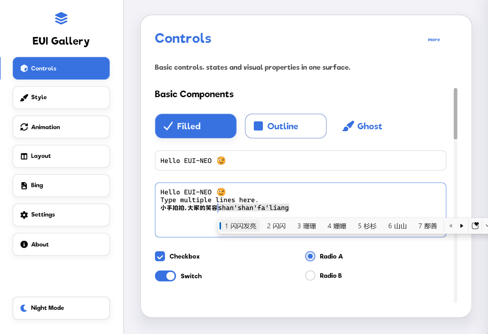
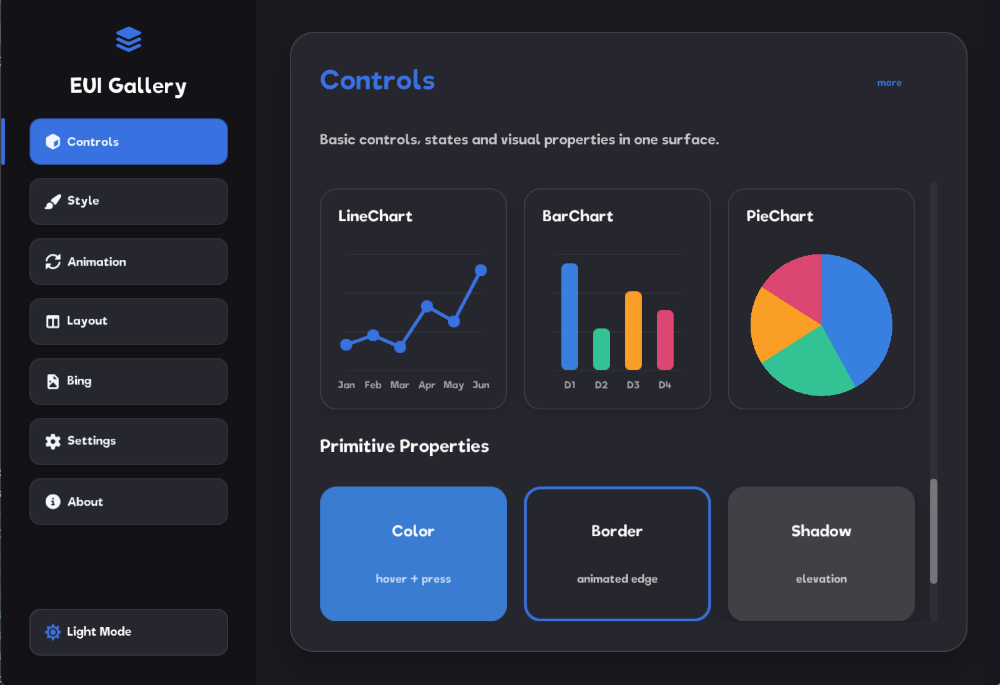
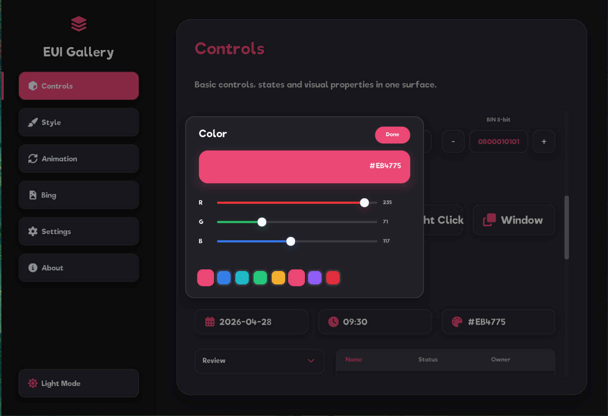
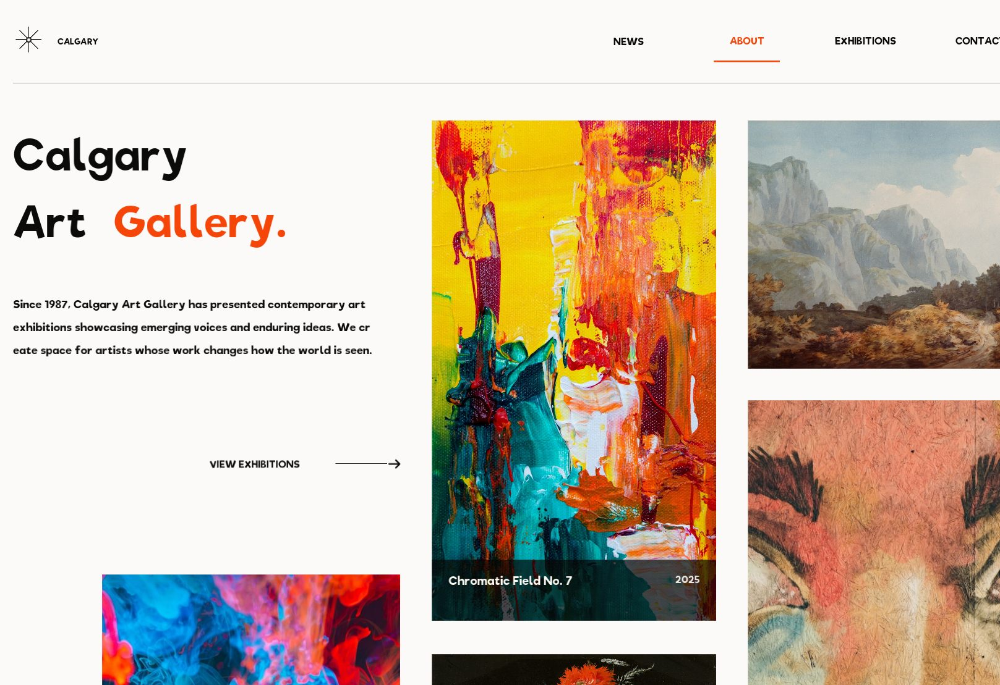
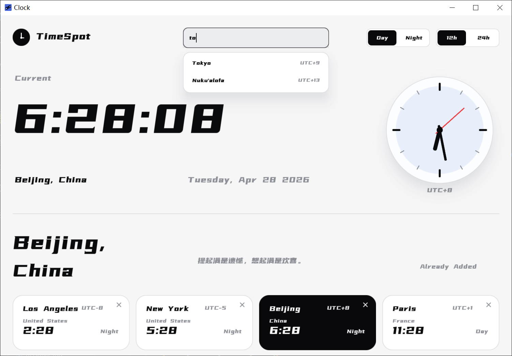
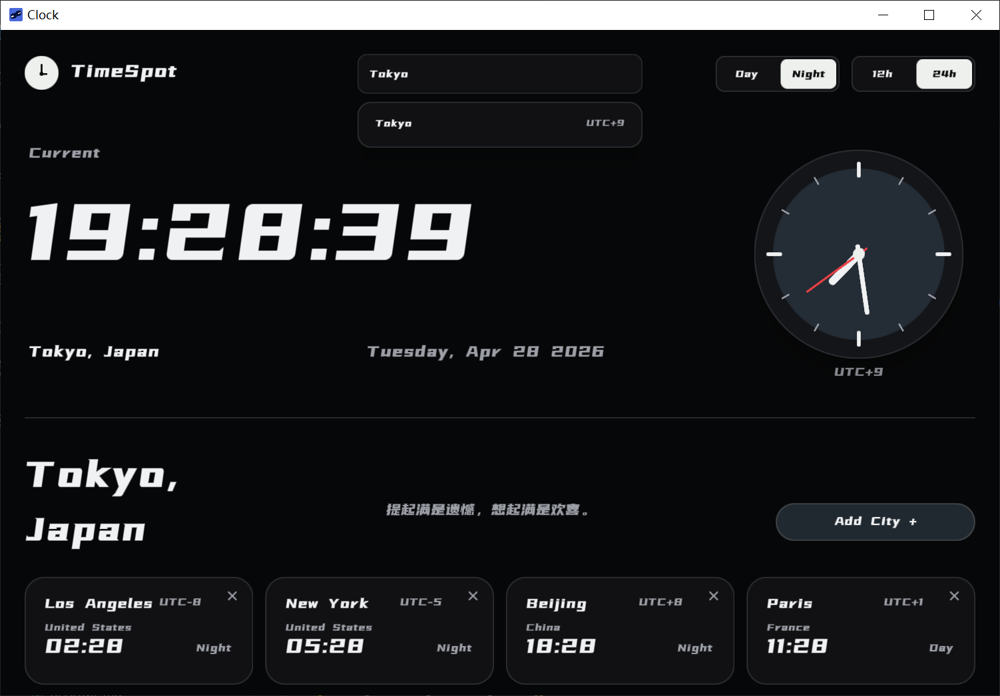

# EUI-NEO

> **Open to work:** I am looking for opportunities in embedded systems, Linux application development, or Qt development. Referrals and opportunities are welcome!

<p align="center">
  
</p>

<p align="center">
  <a href="https://github.com/sudoevolve/EUI-NEO/releases"></a>
  <a href="LICENSE"></a>
  
  
  
  
  <a href="https://github.com/sudoevolve/EUI-NEO/stargazers"></a>
</p>

<p align="center">
  <a href="README.zh-CN.md">简体中文</a>
  ·
  <a href="https://sudoevolve.github.io/EUI-NEO/">Website</a>
</p>

EUI-NEO is a cross-platform, high-performance, low-overhead C++17 UI framework with GLFW/SDL2 window backends and OpenGL/Vulkan render backends.

## Preview

|  |  |
| --- | --- |
|  |  |
|  |  |
|  |  |

## Quick Start

Requirements:

- CMake 3.14+
- A C++17 compiler: MSVC 19.29+ (Visual Studio 2019 16.11+), GCC/MinGW-w64 12+, or Clang 14+
- OpenGL development files for the default renderer

Add EUI-NEO under `3rd/EUI-NEO`, then create:

If the GitHub clone fails, use the AtomGit mirror as a fallback:

```sh
git clone https://atomgit.com/sudoevolve/EUI-NEO.git 3rd/EUI-NEO
```

```cmake
cmake_minimum_required(VERSION 3.14)
project(MyProject LANGUAGES C CXX)

set(CMAKE_CXX_STANDARD 17)
set(CMAKE_CXX_STANDARD_REQUIRED ON)

add_subdirectory(3rd/EUI-NEO)

add_executable(my_app main.cpp)
eui_neo_configure_app(my_app)
```

`main.cpp`:

```cpp
#include "eui_neo.h"

namespace app {

const DslAppConfig& dslAppConfig() {
    static const DslAppConfig config = DslAppConfig{}
        .title("My App")
        .pageId("my_app")
        .windowSize(960, 640);
    return config;
}

void compose(eui::Ui& ui, const eui::Screen& screen) {
    ui.column("root")
        .size(screen.width, screen.height)
        .padding(32.0f)
        .content([&] {
            ui.text("title")
                .text("Hello EUI-NEO")
                .fontSize(28.0f)
                .build();
        })
        .build();
}

} // namespace app
```

Build:

```sh
cmake -S . -B build -DCMAKE_BUILD_TYPE=Release
cmake --build build --config Release --parallel
```

On Windows with the Visual Studio generator, run:

```powershell
.\build\Release\my_app.exe
```

On Linux or macOS, run:

```sh
./build/my_app
```

`eui_neo_configure_app()` adds the selected GLFW/SDL2 entry point, links `eui::neo`, applies platform executable settings, and deploys the runtime assets. The application does not reference files under `core/`.

The release SDK supports the same target setup:

```cmake
find_package(EuiNeo CONFIG REQUIRED)
add_executable(my_app main.cpp)
eui_neo_configure_app(my_app)
```

See the [Integration Guide](docs/guides/integration.md) for installation, `FetchContent`, and SDL2/Vulkan selection. See [Development And Release](docs/development/build-and-release.md) for building this repository and dependency requirements.

## Optional Modules

Optional feature modules live under `modules/` and are documented in the [Modules Guide](docs/guides/modules.md).

## Project Layout

```text
assets/       Runtime assets: fonts, PNG, SVG, and icons
components/   Reusable UI components built on top of the DSL
core/         DSL, Runtime, primitives, text, image, network, and platform code
docs/         User guides, architecture, and development documentation
internal/     Plans, reviews, validation records, and benchmark data
examples/     Short, single-screen API demonstrations
modules/      Optional feature modules such as keyboard and serial
apps/         Longer or multi-page applications; each app lives in its own folder
include/      Public include path: eui_neo.h and eui/* facade headers
tests/        Probe sources, fixture apps, and local benchmark notes
3rd/          Vendored third-party build sources and single-file dependencies
```

## Docs

Start with the [Documentation Index](docs/README.md). It separates application guides, architecture, and development workflows. Historical reviews, plans, and benchmark data live under `internal/`.

- [Contribution Guidelines](CONTRIBUTING.md)
- [DSL Design And Current Implementation](docs/guides/dsl.md)
- [Components](docs/guides/components.md)
- [Modules](docs/guides/modules.md)
- [State Model](docs/guides/state.md)
- [Layout](docs/guides/layout.md)
- [Events](docs/guides/events.md)
- [Animation](docs/guides/animation.md)
- [Async](docs/guides/async.md)
- [Render Backend Architecture And Pipeline](docs/architecture/rendering.md)
- [Retained Layer Cache](docs/architecture/retained-layers.md)
- [Images](docs/guides/images.md)
- [Audio](docs/guides/audio.md)
- [Network](docs/guides/network.md)
- [Platform Capabilities](docs/guides/platform.md)
- [Integration Guide](docs/guides/integration.md)
- [Shadertoy Primitive](docs/guides/shadertoy.md)
- [Development And Release](docs/development/build-and-release.md)

## License

EUI-NEO's original source code is licensed under the Apache License 2.0. Third-party code under `3rd/`, optional build-time dependencies fetched by CMake, and bundled fonts or icon fonts under `assets/` follow their respective upstream licenses and copyright notices.

## Contributors

Thank you to everyone who has contributed code, improved the documentation, reported issues, or shared feedback with EUI-NEO.

<a href="https://github.com/sudoevolve/EUI-NEO/graphs/contributors">
  
</a>
